# Hi there! 👋 I'm Olzhas

**Lead Software Developer | C# | .NET | Autodesk Revit**

I build open-source libraries, developer tools, and automation solutions for the **Autodesk Revit** and **BIM** ecosystem.

- 🛠️ Developing tools and libraries for Revit add-in development.
- 💻 Focused on C#, .NET, Revit API, and software architecture.

### 🚀 Open Source Projects

- **[pyRevit](https://github.com/pyrevitlabs/pyRevit)** — Core Contributor. A rapid application development environment for Autodesk Revit.
- **[Bim4Everyone](https://github.com/Bim4Everyone)** — Creator and Lead Developer. An open-source platform for automating BIM workflows in Autodesk Revit.
- **[RevitCoreConsole](https://github.com/dosymep/RevitCoreConsole)** — Automation and headless processing of Revit models.

### 🔧 Tech Stack

C# · .NET · Python · Autodesk Revit API · WPF · MVVM · BIM Automation · GitHub Actions

### 🌐 Links

- **Website:** [dosymep.net](https://dosymep.net/)
- **Bim4Everyone:** [bim4everyone.com](https://bim4everyone.com/)
- **GitHub:** [@dosymep](https://github.com/dosymep)

---

